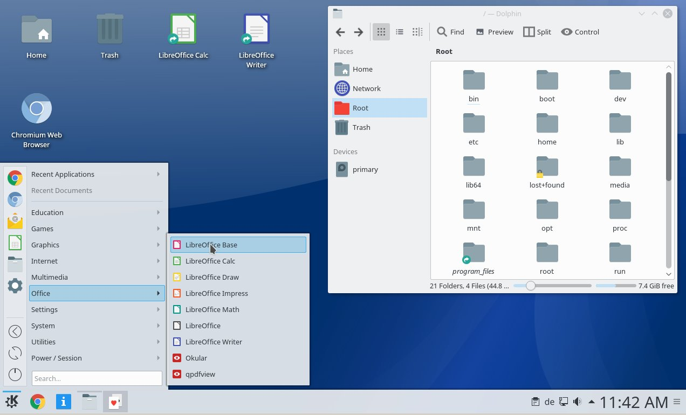
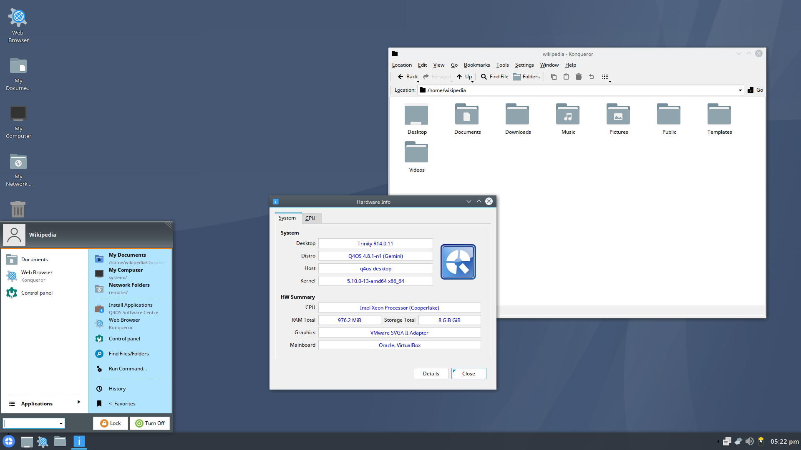

# Q4OS: A Debian Desktop for Everyday Work

Choose the desktop around the work the computer must perform: browsing, documents, media, or a few focused applications. Q4OS combines a Debian software base with Trinity and Plasma editions, giving q4os linux users a choice of desktop experience without changing the underlying package-management approach.

## Match the Desktop to the Workload

The q4os trinity edition offers a lightweight, traditional desktop. The q4os plasma edition provides KDE's more extensive desktop environment and customization tools.

The official published minimums provide a starting point for comparing the editions:

| Edition | CPU | RAM | Disk space |
| --- | --- | --- | --- |
| Trinity | 500 MHz | 512 MB | 6 GB |
| Plasma | 1 GHz | 2 GB | 8 GB |

These are system minimums, not a promise that a modern browser or large document will work comfortably within the same memory budget. Evaluate the applications you actually use.

For a q4os desktop on an older laptop, prioritize usable application performance, readable text, and working peripherals over extra visual effects.

[](https://q4os-linux.github.io/Q4os-Trinity/)

### Keep Release and Architecture Together

The q4os andromeda series is based on Debian 13. The official media page lists its Trinity and Plasma editions for x64 systems.

Older 32-bit machines use the separate Aquarius Trinity release. An edition name, processor architecture, and support period should be considered together rather than treating every Q4OS image as interchangeable.

Check the [official media page](https://q4os.org/downloads1.html) for the supported combinations and current requirements.

## Select Applications by the Tasks You Repeat

The Software Centre offers selected applications, while Debian and Q4OS repositories provide a broader software collection. Synaptic and Plasma's Discover offer graphical package-management options.

Build a practical software set around a few recurring tasks:

- Documents: check that the office suite opens the formats you receive.
- Browsing: test the sites, video calls, and media you normally use.
- Files: confirm that removable storage and network locations fit your routine.
- Printing: check the actual printer model and the functions you need.

On an installed Q4OS system, these Bash commands refresh package information and add LibreOffice from the configured repositories:

```bash
sudo apt update
sudo apt install libreoffice
```

Review the package manager's proposed changes before accepting them. The [application guide](https://q4os.org/dqa006.html) explains the Software Centre and repository-based software management.



### Use the Desktop Profiler for Desktop Choices

Q4OS provides the Desktop Profiler for selecting desktop environments and software profiles. Its documented command is swprofiler.exu.

When several desktop sessions are available, choose the intended session at login. Changing the selected session is different from merely changing the theme.

## Make Everyday Controls Predictable

Set the keyboard layout, language, display scaling, and pointing-device behavior around how you use the machine. Recheck these settings when connecting an external monitor or changing users.

In Trinity, the Control Panel provides settings for screen scaling and regional preferences. The Q4OS manual also documents choosing between single-click and double-click activation.

### Give a Repeated Task a Launcher

A launcher should identify the application it opens. If LibreOffice is installed and its executable is available, this desktop-entry example defines a simple office-suite launcher:

```ini
[Desktop Entry]
Type=Application
Name=Office Documents
Exec=libreoffice
Icon=libreoffice-startcenter
Terminal=false
Categories=Office;
```

Use the desktop's launcher-management interface or application-menu integration to place an entry where it is useful. The example uses the standard [Desktop Entry keys](https://specifications.freedesktop.org/desktop-entry/latest/recognized-keys.html).

The launcher starts LibreOffice; it does not change desktop environments or install the application.

### Judge Themes by Readability

Check menu contrast, icon recognition, and text size after changing a theme. A familiar visual layout is useful when it makes frequently used controls easier to find.

Test keyboard navigation and the application switcher as well as mouse interaction. Keep a layout that remains understandable across the applications you use.



## Maintain the Installed System as a Whole

Use the configured Q4OS and Debian repositories as the basis for routine maintenance. The graphical Update Manager can notify you about available updates.

The official Q4OS manual documents this Bash sequence for requesting an immediate system update:

```bash
sudo apt update
sudo apt dist-upgrade
```

The first command refreshes package metadata. The second resolves a system upgrade and may propose dependency changes, including package removals; read that proposal before proceeding.

This sequence updates packages from the configured repositories. Moving between major distribution releases is a separate procedure.

### Keep Desktop Additions Separate from System Updates

A new theme, widget, or desktop extension can have its own compatibility requirements. Record what you added so that a desktop behavior change can be traced to the relevant component.

For a reproducible workstation setup, retain the release, desktop edition, required applications, and important user preferences alongside your regular backups.

The [Trinity user manual](https://q4os.org/dqa007.html) covers desktop configuration, alternative environments, languages, and software maintenance.

## Companion Desktop References in This Collection

The supplied files come from Cinnamon, a separate desktop project. They provide comparison and implementation references; Q4OS and Trinity source files are absent from this collection, and the commands above target an installed Q4OS system.

### Session Selection and Application Menus

[cinnamon.session.in](cinnamon.session.in) and [cinnamon-wayland.session.in](cinnamon-wayland.session.in) describe Cinnamon session components for different display-server paths.

[generate_additional_files.py](generate_additional_files.py) generates desktop integration entries. The manuals [cinnamon-settings.1](man/cinnamon-settings.1) and [cinnamon-menu-editor.1](man/cinnamon-menu-editor.1) describe Cinnamon settings and menu editing.

For session behavior, [cinnamon.1](man/cinnamon.1) documents the desktop executable, while [cinnamon-launcher.1](man/cinnamon-launcher.1) describes its session launcher.

### Extensions and Runtime Support

[updates.py](python3/cinnamon/updates.py) manages update operations for Cinnamon add-on types. [harvester.py](python3/cinnamon/harvester.py) contains add-on retrieval support, and [logger.py](python3/cinnamon/logger.py) implements activity logging.

[cinnamon-looking-glass.1](man/cinnamon-looking-glass.1) documents Cinnamon's debugging interface. [cinnamon-screensaver-lock-dialog.1](man/cinnamon-screensaver-lock-dialog.1) documents its screensaver message dialog.

### Packaging, Languages, and Attribution

[meson.build](python3/meson.build) installs the supplied Python modules. Another [meson.build](install-scripts/meson.build) registers the installation helper implemented by [add_symlink.py](install-scripts/add_symlink.py).

[README](po/README) explains the translation workflow, and [POTFILES.in](po/POTFILES.in) lists translation extraction inputs.

[check-for-missing.py](tools/check-for-missing.py) checks tracked files against a distribution tree. It is a packaging helper rather than a desktop configuration tool.

[AUTHORS](AUTHORS) points to Cinnamon contributors. [COPYING](COPYING) contains the supplied GNU GPL version 2 license text.

## Related Search Terms

q4os linux, q4os trinity, q4os plasma, q4os desktop, q4os andromeda, q4os, linux, debian, trinity, kde-plasma, desktop-environment, lightweight-linux, operating-system, package-management, qt
